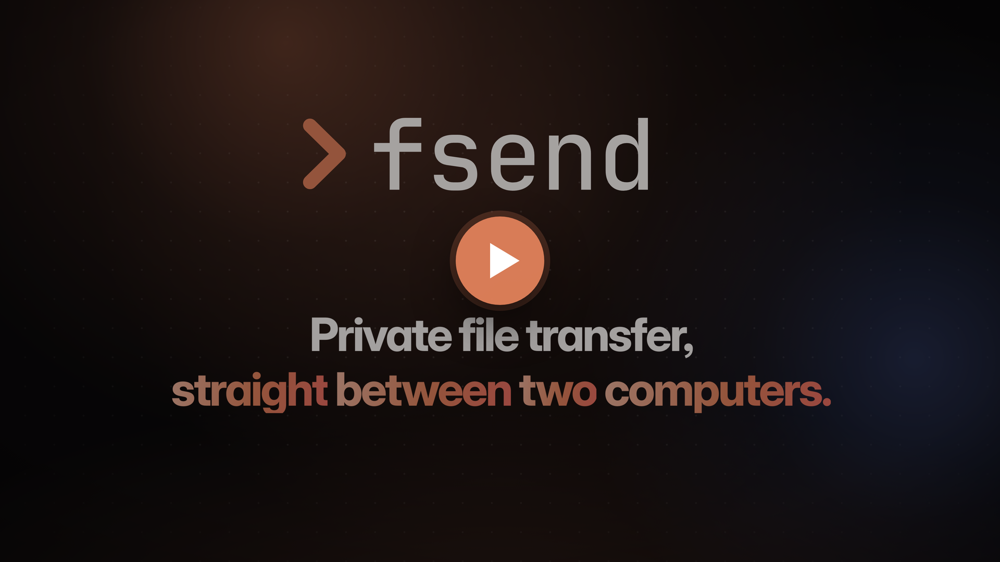

<p align="center">
  <picture>
    <source media="(prefers-color-scheme: dark)" srcset="docs/assets/icon-dark.svg">
    
  </picture>
</p>

<h3 align="center">Private file transfer, straight between two computers.</h3>

<p align="center">One command to send, one to receive.<br>End-to-end encrypted. No account, nothing to configure.</p>

<p align="center">
  <a href="https://github.com/polius/fsend/actions/workflows/checks.yml"></a>
  <a href="https://github.com/polius/fsend/releases"></a>
  <a href="LICENSE"></a>
  <a href="https://fsend.alzina.dev/metrics.json"></a>
</p>

<p align="center">
  <a href="#install">Install</a> ·
  <a href="#why-fsend">Why fsend</a> ·
  <a href="#usage">Usage</a> ·
  <a href="#how-it-compares">Comparison</a> ·
  <a href="#how-it-works">How it works</a> ·
  <a href="#security">Security</a> ·
  <a href="#documentation">Docs</a>
</p>

<p align="center">
  <picture>
    <source media="(prefers-color-scheme: dark)" srcset="docs/assets/demo.svg">
    ' in ~/Downloads, accepts, and the file is saved there.">
  </picture>
</p>

## Install

**Linux, macOS, FreeBSD** (x86 and ARM):

```bash
curl -fsSL https://getfsend.alzina.dev | sh
```

**macOS**, with [Homebrew](https://brew.sh):

```bash
brew install polius/tap/fsend
```

**Windows**, in PowerShell:

```powershell
irm https://getfsend.alzina.dev/windows | iex
```

Then send your first file:

```bash
fsend backup.zip        # prints a code to share
fsend abc-defg-jkm      # run this on the other computer
```

<details>
<summary>Other ways to install</summary>

From source:

```bash
go install github.com/polius/fsend/cmd/fsend@latest
```

Linux packages: each release attaches `.deb`, `.rpm` and `.apk` files.
Install one with `sudo apt install ./fsend_<version>_amd64.deb`,
`sudo dnf install ./fsend-<version>-1.x86_64.rpm` or
`sudo apk add --allow-untrusted fsend_<version>_x86_64.apk`, and update by
installing the next release's package the same way.

Or grab a release binary from [the releases page](https://github.com/polius/fsend/releases).

</details>

<details>
<summary>Update, uninstall and tab-completion</summary>

`fsend --update` installs the latest release, and `fsend --uninstall` removes
fsend and its settings. A Homebrew or package install is left to brew or the
package manager.

For tab-completion, add the line for your shell to its rc file (`$PROFILE` on
PowerShell):

```bash
eval "$(fsend completion zsh)"                                 # zsh
eval "$(fsend completion bash)"                                # bash
fsend completion fish | source                                 # fish
fsend completion powershell | Out-String | Invoke-Expression   # powershell
```

The deb, rpm and apk packages install completions for bash, zsh and fish
already, and the man pages (`man fsend`). Release archives carry the same
scripts in `completions/` and the pages in `manpages/`.

</details>

## Why fsend

- **Direct.** The bytes go straight from sender to receiver, on one network
  or across the internet. An encrypted relay is only the fallback.
- **Private.** End-to-end encrypted, with a post-quantum key exchange. The
  server never learns the code, the file names or the contents.
- **Fast.** Parallel connections and compression fill your link: 10,939 small
  files cross a lossy 100 Mbit/s path in 4.8 s ([benchmarks](#how-it-compares)).
- **Resumable.** A dropped transfer continues where it stopped. Re-sending a
  folder moves only what changed.
- **Send anything.** A file, a folder, several at once, a pipe, or a line of
  text.
- **Runs anywhere.** One static binary for Linux, macOS, FreeBSD and Windows,
  on x86 and ARM.
- **Scriptable.** `--json` output, documented exit codes, and `fsend doctor`
  to diagnose a connection.

## Usage

**Send.** fsend prints a short code to share:

```bash
fsend backup.zip                   # a single file
fsend ./project                    # a whole folder
fsend a.txt b.txt c.txt            # several files at once
pg_dump mydb | fsend               # a stream from stdin
fsend --text "wifi: hunter2"       # a line of text
fsend backup.zip --password        # gated behind a password
```

**Receive.** Run fsend with that code on the other computer:

```bash
fsend abc-defg-jkm                    # save to the current folder
fsend --yes abc-defg-jkm              # skip the confirmation prompt
fsend --out ~/Downloads abc-defg-jkm  # save to a specific folder
fsend --out - abc-defg-jkm | tar x    # stream to stdout (a folder arrives as tar)
```

No fsend on the other computer? The sender also prints a one-line command
that installs it and receives the file. More in [Usage](docs/usage.md).

## How it compares

| | **fsend** | **croc** | **magic-wormhole** | **sendme** | **LocalSend** |
|---|:---:|:---:|:---:|:---:|:---:|
| Works across the internet | ✓ | ✓ | ✓ | ✓ | ✗ |
| Direct transfer, whatever the size | ✓ | ✗ | ✗ | ✓ | LAN only |
| Works with only port 443 open | ✓ | ✗ | ✗ | ✓ | — |
| Post-quantum key exchange | ✓ | ✗ | ✗ | ✗ | ✗ |
| No part of the code reaches a server | ✓ | ✗ | ✗ | — | — |
| Strength of the default code | ~45 bits | ~31 bits | 16 bits | — | — |
| Stdin and stdout streaming | ✓ | ✓ | ✗ | ✗ | ✗ |

**Speed** on an emulated internet link (100 Mbit/s, 30 ms round trip, 0.1%
packet loss), fsend direct and croc through its own relay:

| | **fsend** | **croc** |
|---|:---:|:---:|
| One 256 MiB file (random data) | **25 s** | 30 s |
| 657 MB of source code | **13 s** | 47 s |
| 10,939 small files (139 MB) | **4.8 s** | 45 s |

<details>
<summary>Each tool's raw speed and memory, with both ends on one machine</summary>

<br>

With no network in between, these show each tool's own ceiling, not what
you'll see between two computers.

The route each tool uses on one network:

| | **fsend** | **croc** | **magic-wormhole** | **sendme** | **LocalSend** |
|---|:---:|:---:|:---:|:---:|:---:|
| One 1 GiB file | 0.9 s | 1.9 s | 21 s | 25 s | **0.7 s** |
| 5,000 files of 20 KiB | **1.6 s** | 9.1 s | 5.8 s | 35 s | 2.3 s |

The route each tool uses between networks. croc sends its 1 GiB file over
Tailscale's WireGuard here, not the relay tested above:

| | **fsend** | **croc** | **magic-wormhole** | **sendme** | **LocalSend** |
|---|:---:|:---:|:---:|:---:|:---:|
| One 1 GiB file | **19 s** | 34 s | 21 s | 25 s | LAN only |
| 5,000 files of 20 KiB | **2.7 s** | 9.8 s | 5.8 s | 35 s | LAN only |

Peak memory sending one 1 GiB file (sender / receiver):

| | **fsend** | **croc** | **magic-wormhole** | **sendme** |
|---|:---:|:---:|:---:|:---:|
| Peak memory | 34 / 35 MiB | 37 / 34 MiB | 65 / 65 MiB | **20 / 18 MiB** |

fsend's figure includes the Argon2id stretch that protects the share code.

</details>

Method, sources and where the other tools win:
[full comparison](docs/comparison.md).

## How it works

A share code pairs the two computers, and fsend takes the fastest route that
works:

| Route | When | How |
|---|---|---|
| **Local network** | Same network | Found over mDNS. The data never touches a server. |
| **Direct** | Different networks | NAT hole punching, then peer to peer over QUIC. |
| **Relay** | No direct path | The server forwards encrypted data it can't read. |

The default server, `fsend.alzina.dev`, is free and best effort. The same
binary lets you [run your own](docs/self-hosting.md).

<br>

<p align="center">
  <a href="https://pol.alzina.dev/videos/fsend.mp4">
    
  </a>
</p>

<p align="center"><em>A 65-second video (MP4) on pairing and the three routes.
Prefer reading? See <a href="docs/architecture.md">Architecture</a>.</em></p>

## Security

- **Encryption:** TLS 1.3 between the two computers, never ending at the
  server.
- **Key exchange:** X25519MLKEM768, a post-quantum hybrid, with no classical
  fallback.
- **Authentication:** CPace, a PAKE that binds the share code to the TLS
  session. A man in the middle, even the server, fails before any data moves.
- **Integrity:** a BLAKE3 hash per file, checked before the file is kept.
- **What the server sees:** IP addresses, the fsend version and a value derived
  from the code. It stores nothing on disk.
- **Releases:** reproducible builds, a Sigstore signature, build attestations
  and an SBOM.

The whole threat model is in [Security](docs/security.md).

## Documentation

| | |
|---|---|
| [Usage](docs/usage.md) | Every flag, env var, and exit code |
| [Architecture](docs/architecture.md) | The three routes, and how fsend picks one |
| [Security](docs/security.md) | Threat model, and what the server can and cannot see |
| [Comparison](docs/comparison.md) | fsend vs croc, magic-wormhole, sendme and LocalSend |
| [Self-hosting](docs/self-hosting.md) | Run your own pairing server |
| [FAQ](docs/faq.md) | Short answers: privacy, routes and ports, speed, updating |
| [Troubleshooting](docs/troubleshooting.md) | Common errors and what to do about them |
| [Version compatibility](docs/compatibility.md) | Which versions work together; release notes on [GitHub Releases](https://github.com/polius/fsend/releases) |
| [Development](docs/development.md) | Build and test from source |

## Contributing

Bug reports and pull requests are welcome: open an
[issue](https://github.com/polius/fsend/issues), or see
[Development](docs/development.md) to build from source. Report
vulnerabilities privately, through the [security policy](SECURITY.md).

If fsend is useful to you, a star helps other people find it.

## License

[MIT](LICENSE)
