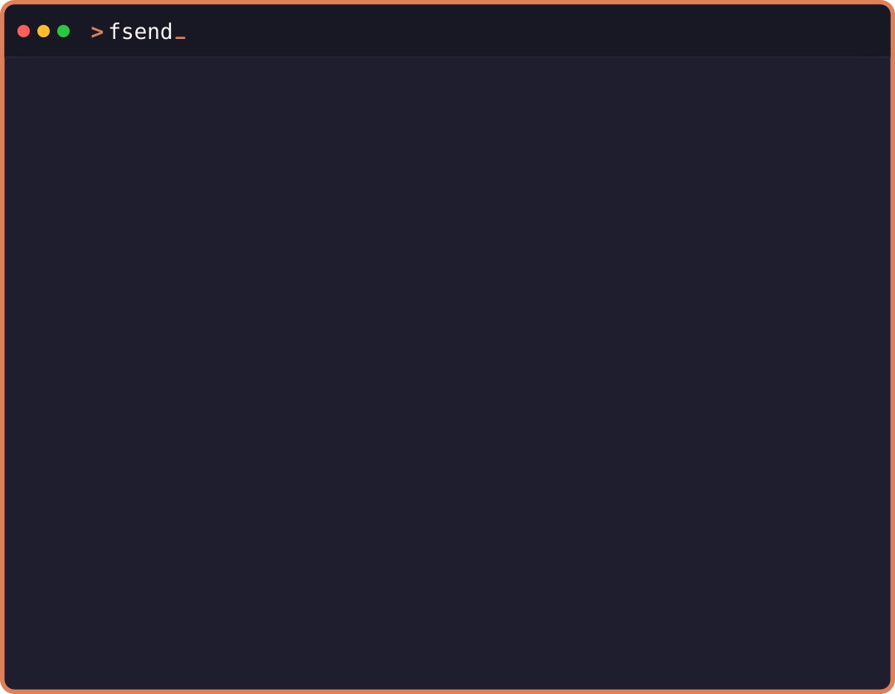
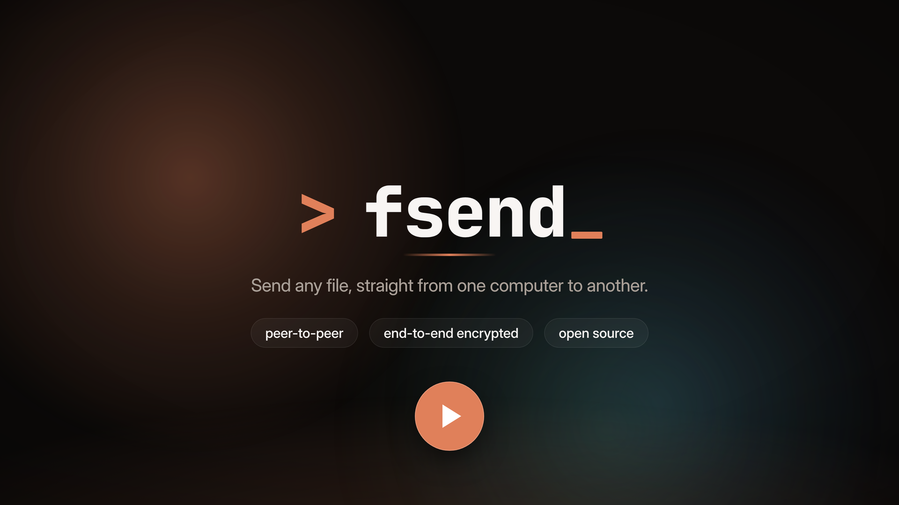

<p align="center">
  <picture>
    <source media="(prefers-color-scheme: dark)" srcset="docs/assets/icon-dark.svg">
    
  </picture>
</p>

<p align="center"><strong>Private file transfer, straight between two computers.</strong></p>

<p align="center">
  <a href="https://github.com/polius/fsend/actions/workflows/checks.yml"></a>
  <a href="https://github.com/polius/fsend/releases"></a>
  <a href="LICENSE"></a>
  <a href="https://fsend.alzina.dev/health"></a>
</p>

<p align="center">
  ', accepts, and the file lands in ~/Downloads.">
</p>

<p align="center"><em>One command to send, one to receive.</em></p>

## Why fsend

`fsend` moves a file from one computer to another with as little ceremony as
possible. No account, no upload step, no ports to open — just two commands and a
short share code.

- **Direct by default** — on the same network or across NATs that can be
  hole-punched, the bytes go straight from sender to receiver. A relay is used
  only when a direct path can't be found.
- **End-to-end encrypted** — TLS 1.3 between the peers, authenticated by the
  share code through a PAKE (CPace) bound to the TLS session. Even the
  fallback relay only ever sees ciphertext.
- **No network setup** — works behind NAT, and falls back to a relay over
  HTTPS (TCP 443) when a network blocks UDP. Nothing to configure.
- **Send anything** — a file, a folder, several at once, a stdin stream, or a
  literal string.
- **Resumable** — if a transfer drops, the next send picks up where it left off
  instead of starting over.
- **Skips what's there** — re-send a folder and only the new or changed files move.
- **One receiver per code** — the first receiver to connect owns the
  transfer; if it drops, only that device can resume it.
- **Optional password** — gate any transfer with `--password`.
- **PQ-hybrid key exchange** — X25519MLKEM768, required between peers, so
  recorded transfers stay private against a future quantum computer.
- **Runs anywhere** — one static binary for Linux, macOS, FreeBSD and Windows,
  on x86 and ARM. Self-host the pairing server if you like.

## Install

**Linux, macOS, FreeBSD** — x86 and ARM:

```bash
curl -fsSL https://getfsend.alzina.dev | sh
```

**macOS** — if you prefer [Homebrew](https://brew.sh):

```bash
brew install polius/tap/fsend
```

**Windows** — run this in PowerShell:

```powershell
irm https://getfsend.alzina.dev/windows | iex
```

Releases are signed (keyless Sigstore) and carry GitHub build attestations;
the install script and `fsend --update` verify checksums, and the signature
too when `cosign` is installed. See
[Security → Release integrity](docs/security.md#release-integrity).

<details>
<summary>Other install methods</summary>

From source:

```bash
go install github.com/polius/fsend/cmd/fsend@latest
```

Or grab a release binary from [the releases page](https://github.com/polius/fsend/releases).

</details>

<details>
<summary>Tab-completion (optional)</summary>

Add the line for your shell to its rc file (`$PROFILE` on PowerShell):

```bash
eval "$(fsend completion zsh)"                                 # zsh
eval "$(fsend completion bash)"                                # bash
fsend completion fish | source                                 # fish
fsend completion powershell | Out-String | Invoke-Expression   # powershell
```

</details>

## Examples

Send a file, a folder, several at once, a stdin stream, or a literal string:

```bash
fsend ./project                    # a whole folder
fsend a.txt b.txt c.txt            # several files at once
pg_dump mydb | fsend               # a stream from stdin
fsend --text "wifi: hunter2"       # a literal string
fsend backup.zip --password        # gated behind a password
```

…and to receive:

```bash
fsend --yes abc-defg-jkm              # skip the confirmation prompt
fsend --out ~/Downloads abc-defg-jkm  # save to a specific folder
fsend --out - abc-defg-jkm | tar x    # stream to stdout (a folder arrives as tar)
```

## How it works

<p align="center">
  <a href="https://getfsend.alzina.dev/video.mp4">
    
  </a>
</p>

## Documentation

| | |
|---|---|
| [Architecture](docs/architecture.md) | Three transfer modes, raced concurrently — and why |
| [Security](docs/security.md) | Threat model — what the server can and cannot see |
| [Usage](docs/usage.md) | Every flag, env var, and exit code |
| [Self-hosting](docs/self-hosting.md) | Run your own pairing server in three steps |
| [Development](docs/development.md) | Build and test from source |
| [Troubleshooting](docs/troubleshooting.md) | Common errors and what to do about them |

## Comparison

**[fsend vs croc vs magic-wormhole vs sendme vs LocalSend](docs/comparison.md)**
— a side-by-side table on security, network, and tooling, plus the
trade-offs.

## Contributing

Bug reports and pull requests welcome — see [Development](docs/development.md) to build from source, or open an [issue](https://github.com/polius/fsend/issues).

## License

MIT
